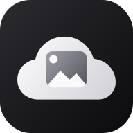

<p align="center">
  
</p>

<h1 align="center">Purer</h1>

<p align="center">只保留云服务浏览的 Android 相册应用</p>

Purer 是一款用于浏览 **WebDAV / SMB** 网络相册的独立 Android 应用。应用启动后
直接进入云服务列表，不扫描本地媒体库。

## 功能

- 管理 WebDAV、SMB 服务（名称、地址、账号、TLS 选项）
- 网格 / 列表 / 马赛克三种浏览布局，可双指缩放调整列数
- 远端图片缩略图，远端视频由系统媒体栈抽帧（libmpv 作为后备）
- 抽帧速率限制（默认 2 次/秒，可按文件夹覆盖）与后台缩略图刮削（带详情页：
  进度、每个视频的结果与失败原因、失败重试、单个视频重试）
- 可选的 WebDAV 共用缓存：缩略图按原目录结构镜像保存，文件名带视频时长
  （如 `00.10.00_vid.mp4.jpg`），重新刮削时一次列目录即可跳过已完成视频；
  无法解码等会重复出现的失败也会记录为 `<视频名>.failed-<原因>`，后续刮削直接
  跳过，成功或手动重试后自动清除
- 缩略图刮削可随时停止，之后从停止的位置继续；批量选择后可重新生成缩略图
- 运行日志：记录网络、缩略图、刮削、缓存与播放操作，着色、可筛选、可关闭
- 图片查看器：缩放、平移、缩略图条、进度条、自动滚动、自动翻页、
  单页 / 连续画卷、长按放大镜
- 视频播放器：断点续播、倍速、拖动进度、在播放器内切换其他视频
- 按文件夹记住浏览进度、布局、并发数、排序和媒体筛选
- 下载图片与视频帧的磁盘缓存
- 全屏浏览（默认隐藏系统状态栏，可在设置中恢复）
- 界面仅提供简体中文

## 界面

浏览页顶部只保留地址栏和常用操作；查看面板把布局切换固定在顶部，其余选项按
分组折叠，图片查看器的设置面板同样支持收起，不需要长距离滚动。

应用有三个设置入口：「软件设置」管理应用偏好与缩略图缓存，「视图设置」管理
浏览布局、视频与进度，「浏览设置」管理图片查看器的显示与自动浏览。全屏时工具
栏贴近屏幕上沿：前三个操作按钮在左侧，批量选择与视图设置按钮在右侧。

## 构建与安装

仓库不包含构建产物。应用仅提供 **arm64-v8a** 的 release APK，按下方步骤构建后
安装即可；系统要求 Android 7.0（API 24）及以上，安装时需要允许安装未知来源应用。

## 构建

需要 Flutter 3.47.6、JDK 21 和 Android SDK（platform 37、build-tools 37.0.0）。

```bash
flutter pub get
./build_release.sh
```

产物为 `build/app/outputs/flutter-apk/app-arm64-v8a-play-release.apk`。
构建使用 AOT 混淆，符号表输出到 `build/symbols/`，请与应用一起保存以便解析崩溃栈。

如果 Gradle 在 `media_kit_libs_android_video` 下载 libmpv JAR 时失败，可先手动把
JAR 放到 `build/media_kit_libs_android_video/v1.1.7/` 再重新构建（`flutter clean`
会删除该目录）。

## 项目结构

```text
lib/
  main_cloud.dart                 入口
  widgets/cloud_app.dart          应用外壳（主题、本地化、Provider）
  widgets/cloud/                  云服务浏览、查看器、视频与设置界面
  services/media/                 WebDAV / SMB 客户端、取图管线、缓存
  model/settings/modules/cloud.dart  云服务相关偏好
  l10n/app_zh.arb                 界面文案（仅简体中文）
plugins/                          Purer 的内部 Dart 包（模型、视频、工具）
scraper/                          桌面端与浏览器端缩略图刮削辅助脚本
android/app/src/main/kotlin/      平台通道：解码/缩略图、文件选择、窗口
```

## 说明

- 应用 ID 与 Kotlin 包名为 `io.github.beomyo.purer`，Dart 包名为 `purer`。
- 远端图片由 Flutter 引擎解码，远端视频帧由系统媒体栈解码；本地图片解码相关的
  原生库（TIFF/JPEG 等）在打包时已排除。

## 许可证

本项目依据仓库中的 [LICENSE](LICENSE) 文件分发。
